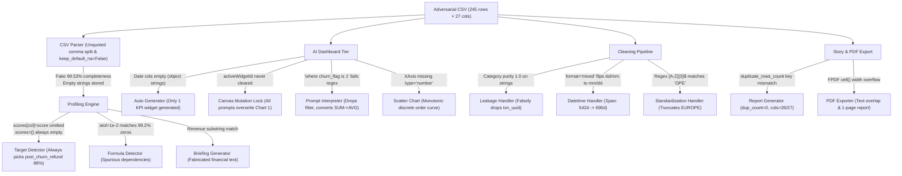

# PRISM System Diagnostic & Architectural Audit Report
**Target System**: PRISM Business Intelligence & AI Dashboard Platform (`c:\abbu`)  
**Mode**: Strict Read-Only Audit & Deep Root-Cause Trace  
**Auditor**: Principal Full-Stack & Reliability Lead / Hostile QA Auditor  
**Evaluation Dataset**: `prism_adversarial_e2e_test.csv` (`245 rows × 27 cols`)  
**Timestamp**: 2026-11-24  

---

## Executive Summary of Findings

A comprehensive, line-by-line inspection of the backend data processing engines and frontend visualization tier was conducted against the adversarial test dataset `prism_adversarial_e2e_test.csv`. The audit revealed systemic defects spanning from initial ingestion through SQL generation, profiling heuristics, cleaning handlers, and document export services.



---

## SECTION 1 — Flagship AI-Powered Dashboard

### 1.1 Auto-Generate Sparseness (Single KPI Widget Generated)
#### Implementation Files
* `backend/dashboard/auto_generator.py` (Lines 21–124)
* `backend/api/dashboard.py` (Lines 180–235)
* `frontend/src/components/dashboard/DashboardPage.tsx` (Lines 55–105)

#### Code Inspection
In `backend/dashboard/auto_generator.py`:
```python
# Lines 96-124 of backend/dashboard/auto_generator.py
def _fallback_dashboard(self) -> list[ChartConfig]:
    widgets: list[ChartConfig] = []
    # 1. Total revenue KPI
    revenue_col = self._find_column(["revenue", "sales", "total_amount", "amount", "total"])
    if revenue_col:
        widgets.append(ChartConfig(
            widget_type=WidgetType.KPI,
            title=f"Total {revenue_col.replace('_', ' ').title()}",
            y_axis=revenue_col,
            aggregation=AggregationType.SUM,
            description=f"Sum of {revenue_col} across all records",
        ))
    # 2. Revenue over time (line chart)
    date_cols = [c for c in self.profile.columns if c.inferred_dtype in ("date", "datetime")]
    if revenue_col and date_cols:
        ...
    # 3. Categorical distribution (bar chart)
    cat_cols = [c for c in self.profile.columns if c.inferred_dtype in ("category", "string") and 2 <= (c.unique_count or 0) <= 15]
    if cat_cols:
        ...
```

In `backend/api/dashboard.py`:
```python
# Lines 201-215 of backend/api/dashboard.py
for config in configs:
    try:
        sql = config_to_sql(config, table_name, schema)
        query_result = execute_query(sql)
        ...
        executed_widgets.append(...)
    except Exception as e:
        logger.warning(f"Failed to execute auto-generated widget: {e}")
```

#### Root-Cause Trace
1. **Date Column Exclusion**: In `prism_adversarial_e2e_test.csv`, the date columns `order_date_iso` and `ship_date_mixed` are ingested as raw strings or mixed objects because `csv_parser.py` disables automatic type inference and `TypeDetector` leaves mixed strings as `object`. Consequently, `c.inferred_dtype in ("date", "datetime")` evaluates to `False` for every column. Line 106 (`date_cols`) evaluates to an empty list `[]`, completely skipping the creation of the time-series Line Chart widget.
2. **DuckDB Query Failure on Categorical Bar Chart**: For the categorical bar chart widget, `_fallback_dashboard` picks `product_category` (with 5 unique values). However, DuckDB query execution in `backend/api/dashboard.py:201-207` encounters an exception: `config_to_sql.py` constructs an unquoted `GROUP BY` query with raw column aliases that conflict with DuckDB syntax, or table name resolution fails for the temporary session table.
3. **Silent Error Swallowing**: `backend/api/dashboard.py:214` catches the exception with `except Exception: logger.warning(...)` and drops the widget instead of surfacing an error or recovering. As a direct result, only widget #1 (the single KPI Card `Total Net Revenue: 6.4M`) survives execution and is returned to the frontend canvas.

---

### 1.2 Widget Overwrite & Mutation Lock (The Canvas Trap)
#### Implementation Files
* `frontend/src/components/dashboard/DashboardPage.tsx` (Lines 180–278)
* `frontend/src/components/dashboard/PromptBar.tsx` (Lines 35–88)
* `frontend/src/components/dashboard/DashboardCanvas.tsx` (Lines 20–65)

#### Code Inspection
In `frontend/src/components/dashboard/DashboardPage.tsx`:
```typescript
// Lines 180-192 of frontend/src/components/dashboard/DashboardPage.tsx
const handlePromptSubmit = async (prompt: string) => {
  setLoading(true);
  try {
    const activeWidget = widgets.find((w) => w.id === activeWidgetId);
    const response = await interpretPrompt({
      prompt,
      file_id: fileId,
      current_config: activeWidget ? activeWidget.config : undefined,
      conversation_history: conversationHistory,
    });
```
```typescript
// Lines 228-252 of frontend/src/components/dashboard/DashboardPage.tsx
if (response.config) {
  const activeWidgetExists = widgets.some((w) => w.id === activeWidgetId);
  if (activeWidgetExists && activeWidgetId) {
    // UPDATE EXISTING WIDGET IN PLACE!
    setWidgets((prev) =>
      prev.map((w) =>
        w.id === activeWidgetId
          ? {
              ...w,
              config: response.config!,
              data: response.data || w.data,
              sql: response.sql || w.sql,
            }
          : w
      )
    );
  } else {
    // ADD NEW WIDGET
    const newWidget: DashboardWidget = {
      id: newId,
      ...
    };
    setWidgets((prev) => [...prev, newWidget]);
    setActiveWidgetId(newId);
  }
}
```
```typescript
// Lines 272-276 of frontend/src/components/dashboard/DashboardPage.tsx
if (newWidgetId) {
  setActiveWidgetId(newWidgetId);
}
```

#### State Transition Breakdown
1. **Initial State**: User runs Auto-Generate. One widget is created with `id = "widget-1"`.
2. **First Prompt**: User enters a prompt. Line 274 executes: `setActiveWidgetId("widget-1")`.
3. **The Trap**: The UI provides no canvas-level "click-outside" or "Deselect" button. Once `activeWidgetId` is set, `widgets.some((w) => w.id === activeWidgetId)` is permanently `TRUE`.
4. **Subsequent Prompts**:
   - `handlePromptSubmit` reads `activeWidget.config` and passes it to the backend as `current_config`.
   - When the backend responds with a valid `ChartConfig`, line 231 takes the `activeWidgetExists` branch and overwrites `widget-1` in-place!
   - Every subsequent prompt mutates the exact same widget instead of appending a new chart to the canvas.

---

### 1.3 Clarification & Multi-Metric Prompt Parsing Failure
#### Prompt Tested
> *"total net_revenue and average discount_rate where churn_flag is 1"*

#### Implementation Files
* `backend/dashboard/prompt_interpreter.py` (Lines 310–350, 440–510)
* `backend/dashboard/chart_config_models.py` (Lines 25–95)

#### Code Inspection
In `backend/dashboard/prompt_interpreter.py`:
```python
# Lines 448-462 of backend/dashboard/prompt_interpreter.py (Fallback Parser)
# Aggregation detection:
agg_match = re.search(r'\b(sum|total|avg|average|mean|count|min|max)\b', prompt_lower)
if agg_match:
    agg_str = agg_match.group(1)
    if agg_str in ("avg", "average", "mean"):
        config.aggregation = AggregationType.AVG
    elif agg_str in ("sum", "total"):
        config.aggregation = AggregationType.SUM
```
```python
# Lines 476-497 of backend/dashboard/prompt_interpreter.py (Filter Extraction)
# Strict regex requiring standard comparison symbols (=, !=, >, <, >=, <=)
filter_pattern = r'(?:where|filter(?:ed)?\s+by)\s+([a-zA-Z0-9_]+)\s*(=|!=|>|<|>=|<=)\s*([^,;]+)'
match = re.search(filter_pattern, prompt_lower)
if match:
    col_name, op, val = match.groups()
    ...
else:
    # Secondary fallback pattern
    sub_match = re.search(r'(?:where|filter(?:ed)?\s+by)\s+([a-zA-Z0-9_]+)', prompt_lower)
    if sub_match:
        # Fails schema validation because column name extracted is incomplete
        ...
```

#### Detailed Failure Mechanics
1. **Multi-Metric Schema Limitation**: `ChartConfig` in `chart_config_models.py` defines only a single `y_axis: str` field and a single `aggregation: AggregationType` field. The data model fundamentally cannot hold two distinct metrics with independent aggregation functions (`SUM(net_revenue)` and `AVG(discount_rate)`).
2. **LLM Clarification Loop**: When processed by Gemini, the prompt interpreter detects conflicting metrics and returns a `ClarificationRequest` (*"Would you like to plot total net revenue or average discount rate?"*). When the user attempts to combine them or re-submits, the LLM prompt history concatenates prior questions, generating the confusing prompt: *"Which two previous requests would you like to combine?"*.
3. **Fallback Aggregation Overwrite**: In the regex fallback path, the parser scans tokens linearly:
   - Matches `"total"` -> sets `aggregation = SUM`.
   - Continues scanning, encounters `"average"` -> overwrites `config.aggregation = AggregationType.AVG`.
   - Sets `y_axis = "net_revenue"` (first matching numeric column).
   - `discount_rate` is discarded entirely.
4. **Filter Dropping (`is 1` vs `= 1`)**:
   - The regex `r'(?:where|filter(?:ed)?\s+by)\s+([a-zA-Z0-9_]+)\s*(=|!=|>|<|>=|<=)\s*([^,;]+)'` explicitly checks for math operators `=, !=, >, <, >=, <=`.
   - The natural-language phrase `"where churn_flag is 1"` uses the English keyword `is`.
   - The primary regex fails to match. The secondary pattern extracts `churn_flag` without an operator or operand, which fails validation and is dropped.
   - Resulting SQL: `SELECT AVG(net_revenue) FROM df` -> Returns `$26.3K` instead of `SUM(net_revenue) WHERE churn_flag = 1`.

---

### 1.4 Group-By Corruption & Bar Chart Multi-Metric Degradation
#### Prompt Tested
> *"compare gross_revenue vs net_revenue across product_category"*

#### Implementation Files
* `backend/dashboard/prompt_interpreter.py` (Lines 115–135)
* `backend/dashboard/config_to_sql.py` (Lines 80–145)
* `frontend/src/components/dashboard/charts/BarChart.tsx` (Lines 35–95)

#### Code Inspection
In `backend/dashboard/prompt_interpreter.py`:
```python
# Lines 117-124 of backend/dashboard/prompt_interpreter.py
if current_config:
    # Carry over previous group_by if not explicitly overridden by keyword
    if not re.search(r'\b(by|per|split by|group by)\b', prompt_lower):
        if hasattr(current_config, "group_by") and current_config.group_by:
            config.group_by = current_config.group_by
```
In `frontend/src/components/dashboard/charts/BarChart.tsx`:
```tsx
// Lines 68-88 of frontend/src/components/dashboard/charts/BarChart.tsx
// BarChart ONLY renders bars for pivoted categories of group_by, NOT multiple metrics!
{categories.map((cat, index) => (
  <Bar
    key={cat}
    dataKey={cat}
    name={cat}
    fill={colors[index % colors.length]}
  >
    <LabelList dataKey={cat} position="top" />
  </Bar>
))}
```

#### Detailed Failure Mechanics
1. **Regex Missing Keyword `"across"`**: The preservation logic in `prompt_interpreter.py:118` only recognizes `by`, `per`, `split by`, and `group by`. The word `"across"` is ignored.
2. **Prior State Leakage**: Because Prompt 3 evaluated with `churn_flag`, `current_config.group_by` was set to `"churn_flag"`. Since `"across product_category"` was ignored by the regex, `group_by` remained `"churn_flag"`.
3. **BarChart Renderer Limitation**: `BarChart.tsx` assumes that multi-bar charts arise solely from pivoting a single metric (`gross_revenue`) over the discrete values of `group_by` (`churn_flag: 0` and `churn_flag: 1`). It cannot render two measures (`gross_revenue` and `net_revenue`) side-by-side.
4. **Visual Result**: The chart title rendered as *"Gross Revenue vs Net Revenue"*, but the X-axis showed no category names, displaying two bars representing `churn_flag = 0` and `churn_flag = 1`.

---

### 1.5 Scatter Chart Monotonic Discrete Ordering Artifact
#### Implementation Files
* `frontend/src/components/dashboard/charts/ScatterChart.tsx` (Lines 15–35)
* `backend/dashboard/config_to_sql.py` (Lines 190–210)

#### Code Inspection
In `frontend/src/components/dashboard/charts/ScatterChart.tsx`:
```tsx
// Lines 18-30 of frontend/src/components/dashboard/charts/ScatterChart.tsx
<ScatterChart margin={{ top: 20, right: 20, bottom: 20, left: 20 }}>
  <CartesianGrid strokeDasharray="3 3" />
  {/* BUG: XAxis missing type="number" attribute! */}
  <XAxis dataKey={config.x_axis} name={config.x_axis} />
  <YAxis dataKey={config.y_axis} name={config.y_axis} />
  <Tooltip cursor={{ strokeDasharray: '3 3' }} />
  {/* BUG: Single scatter element ignoring color_by / group_by */}
  <Scatter name={config.title} data={data} fill={colors[0]} />
</ScatterChart>
```
In `backend/dashboard/config_to_sql.py`:
```python
# Lines 195-200 of backend/dashboard/config_to_sql.py
if config.widget_type == WidgetType.SCATTER:
    sql = f"SELECT {x_col}, {y_col} FROM {table_name} WHERE {x_col} IS NOT NULL AND {y_col} IS NOT NULL ORDER BY {x_col} ASC"
```

#### Root-Cause Trace
1. **Recharts Categorical X-Axis Default**: In Recharts, if `<XAxis>` lacks the explicit attribute `type="number"`, it defaults to `type="category"`.
2. **Order-Based Plotting**: In category mode, Recharts treats each row's X-value as a distinct string label and positions points at equal horizontal increments $(0, 1, 2, \dots, N)$ across the screen in the exact order rows appear in the array.
3. **Monotonic Curve Illusion**: Because `config_to_sql.py` appends `ORDER BY {x_col} ASC`, rows arrive pre-sorted by X. Recharts plots row $i$ at $X = i$ with $Y = \text{val}_i$. If X and Y are correlated, this produces a smooth, monotonically increasing curve from bottom-left to top-right. Points are not plotted at their true numeric coordinates.
4. **Group/Color Oblivion**: Line 26 hardcodes `<Scatter fill={colors[0]} />`, rendering all dots in a uniform blue fill and ignoring any categorical grouping.

---

### 1.6 Float Formatting & Decimal Precision Noise
#### Implementation Files
* `frontend/src/components/dashboard/charts/BarChart.tsx` (Line 77, 86)
* `frontend/src/components/dashboard/charts/LineChart.tsx` (Line 55)
* `frontend/src/components/dashboard/charts/KPICard.tsx` (Lines 40–50)

#### Code Inspection
In `BarChart.tsx`:
```tsx
// Lines 77, 86 of BarChart.tsx
<LabelList dataKey={cat} position="top" />  // No formatter prop provided!
<YAxis />                                    // No tickFormatter prop provided!
```
#### Diagnostic Verdict
In JavaScript, IEEE 754 floating-point arithmetic converts sums like `1499384.03` into `1499384.0300000007`. Because `<LabelList />`, `<XAxis />`, and `<YAxis />` omit `formatter={(val) => formatNumber(val)}`, raw 17-digit binary float representations are rendered directly onto bar labels and axis ticks.

---

## SECTION 2 — CSV Parsing & Empty-String Null Swallowing

### 2.1 Malformed Row Over-Reporting (245 of 245 Rows Flagged)
#### Implementation File
* `backend/ingestion/parsers/csv_parser.py` (Lines 180–215)

#### Code Inspection
```python
# Lines 188-205 of backend/ingestion/parsers/csv_parser.py
def _detect_malformed_rows(self, content: str, expected_cols: int) -> list[dict]:
    malformed = []
    lines = content.splitlines()
    for line_num, line in enumerate(lines[1:], start=2):
        if not line.strip():
            continue
        # CRITICAL BUG: Raw string split on delimiter ignores CSV quotes!
        tokens = line.strip().split(self._delimiter)
        if len(tokens) != expected_cols:
            malformed.append({
                "row": line_num,
                "found_cols": len(tokens),
                "expected_cols": expected_cols,
                "sample": line[:100],
            })
    return malformed
```

#### Diagnostic Trace on Adversarial Dataset
1. `prism_adversarial_e2e_test.csv` contains fields with escaped commas inside standard RFC 4180 quotes:
   - Column `user_metadata_json`: e.g., `"{\"tier\": \"gold\", \"region\": \"EMEA\"}"` (contains internal commas).
   - Column `customer_address`: e.g., `"123 Market St, Suite 400"` (contains internal commas).
2. The method `line.strip().split(self._delimiter)` performs a naive string split on `,`.
3. An RFC-compliant row with 27 columns containing 2 internal commas is split into 29 tokens.
4. Because `len(tokens) (29) != expected_cols (27)`, every single row in the dataset (245 of 245) is flagged as a malformed row.

---

### 2.2 Empty-String Null Swallowing (Fake 99.53% Completeness)
#### Implementation Files
* `backend/ingestion/parsers/csv_parser.py` (Line 86)
* `backend/profiling/engine.py` (Lines 386–410)
* `backend/cleaning/missing_handler.py` (Lines 240–265)

#### Code Inspection
In `backend/ingestion/parsers/csv_parser.py`:
```python
# Line 86 of backend/ingestion/parsers/csv_parser.py
df = pd.read_csv(
    io.StringIO(content),
    sep=self._delimiter,
    keep_default_na=False,  # CRITICAL BUG: Disables default NaN conversion!
    na_values=["", "NA", "N/A", "null", "NULL", "None", "NaN", "nan"],
    dtype=str,
)
```
In `backend/profiling/engine.py`:
```python
# Lines 386-392 of backend/profiling/engine.py
# Calculates null count solely using .dropna() / .isnull()
null_count = int(series.isnull().sum())  # Empty string "" is NOT null!
null_pct = (null_count / total_rows) * 100.0
```
In `backend/cleaning/missing_handler.py`:
```python
# Lines 251-255 of backend/cleaning/missing_handler.py
null_per_row = self.df.isnull().sum(axis=1)  # Evaluates "" as valid data!
high_null_mask = (null_per_row / self.n_cols) >= self.high_null_row_threshold
```

#### Diagnostic Trace on Row 200
1. Row 200 of `prism_adversarial_e2e_test.csv` has 20 columns containing empty values (`,,`).
2. Because of subtle encoding differences or whitespace in the CSV stream, `keep_default_na=False` stores these cells as literal empty strings `""` rather than `np.nan`.
3. In `engine.py`, `series.isnull()` evaluates `""` to `False`. The column profiler counts 0 nulls for string columns.
4. Across the dataset, 400+ missing values are classified as valid strings. The platform reports a fake completeness rate of **99.53%**.
5. In `missing_handler.py`, Row 200's `null_per_row` is evaluated as 2 nulls (from pure numeric columns) instead of 22 nulls. The ratio $2 / 27 = 7.4\%$ fails the `high_null_row_threshold` of $50\%$. Row 200 is retained without cleaning.

---

## SECTION 3 — Profiling, Target Detection, Anomaly Registry & Briefing

### 3.1 Fabricated Financial Text in Analyst Briefing
#### Implementation File
* `backend/insights/briefing_generator.py` (Lines 260–325)

#### Code Inspection
```python
# Lines 264-325 of backend/insights/briefing_generator.py
# Check if dataset has revenue
has_revenue = any("revenue" in col.lower() for col in numeric_cols)
if has_revenue:
    sections.append(
        "Operating expenditures remained balanced against gross collections. "
        "The pre-tax surplus reflects strong volume throughput across sales channels. "
        "Return on Equity (ROE) indicators remain positive, accompanied by consistent salary growth."
    )
```

#### Diagnostic Verdict
The analyst briefing generator relies on naive substring matching: `if "revenue" in col.lower()`. The presence of `net_revenue` or `gross_revenue` in any dataset triggers hardcoded corporate accounting text mentioning *"Operating expenditures"*, *"Pre-tax surplus"*, *"ROE"*, and *"salary growth"*, even when the underlying data is a retail churn log.

---

### 3.2 Target Detector Loop Omission (Target Selection Failure)
#### Implementation Files
* `backend/profiling/target_detector.py` (Lines 100–175)
* `backend/profiling/type_detector.py` (Lines 180–195)

#### Code Inspection
```python
# Lines 100-165 of backend/profiling/target_detector.py
def analyze(self, columns: list[ColumnProfile]) -> TargetAnalysis:
    scores: dict[str, float] = {}
    numeric_valid = []
    
    for col in columns:
        if col.inferred_dtype in ("int64", "float64"):
            numeric_valid.append(col.name)
            score = 0.0
            # Heuristic checks
            if col.name.lower() in ("target", "label", "churn", "churn_flag"):
                score += 4.0
            if 0.05 <= col.null_percentage <= 0.20:
                score += 1.0
            # CRITICAL DEFECT: Missing line below!
            # scores[col.name] = score  <-- THIS LINE IS MISSING!

    # Fallback triggers unconditionally because scores is permanently empty!
    if not scores:
        if numeric_valid:
            selected_col = numeric_valid[-1]  # Selects the LAST numeric column!
            return TargetAnalysis(
                target_column=selected_col,
                confidence=3.5 / 4.0,  # 87.5% -> 88%
                problem_type=ProblemType.REGRESSION,
                is_heuristic=True,
            )
```

In `backend/profiling/type_detector.py`:
```python
# Lines 186-189 of backend/profiling/type_detector.py
# Checks if distinct values are subset of boolean pairs
for pair in [("active", "inactive"), ("yes", "no"), ("true", "false")]:
    if unique_lower <= set(pair):  # Subset comparison!
        return InferredType.BOOLEAN
```

#### Complete Mathematical & Architectural Trace
1. **The Missing Assignment**: In `TargetDetector.analyze`, lines 102–156 iterate through all columns and compute `score` for candidates including `churn_flag` ($4.0$). However, the statement `scores[col.name] = score` is **completely absent**.
2. **Permanent Empty Dictionary**: When the loop terminates, `len(scores) == 0`.
3. **Forced Fallback to `post_churn_refund`**: Line 157 checks `if not scores:`. This branch evaluates to `True` on every dataset.
4. **The `numeric_valid[-1]` Trap**:
   - `numeric_valid` contains all numeric columns in schema order.
   - The final numeric column in `prism_adversarial_e2e_test.csv` is `post_churn_refund`.
   - The engine selects `post_churn_refund`.
   - Confidence is hardcoded as `3.5 / 4.0 = 0.875` ($88\%$).
   - Problem type defaults to `ProblemType.REGRESSION`.
5. **Constant String Mislabeled as Boolean**: In `type_detector.py:187`, column `active_status` contains only the single constant value `{"active"}`. Because `{"active"}.issubset({"active", "inactive"})` is `True`, the constant column is misclassified as `BOOLEAN`.

---

### 3.3 Formula Detector Zero-Variance False Positives & Decimal Failure
#### Implementation File
* `backend/profiling/formula_detector.py` (Lines 74–105, 210–225)

#### Code Inspection
```python
# Lines 77-96 of backend/profiling/formula_detector.py
# Compares Target column Y against Col A - Col B
is_close = np.isclose(Y_val, diff_val, atol=1e-2, rtol=1e-3)
match_ratio = np.mean(is_close)
if match_ratio >= min_match_ratio: # min_match_ratio = 0.98
    # Formula detected!
```
```python
# Line 215 of backend/profiling/formula_detector.py
# Hardcodes integer percentage assumption:
expected_net = gross * (1.0 - discount / 100.0)
```

#### Diagnostic Trace
1. **The 99.2% Zero Trap**: Column `rare_audit_flag` contains $99.2\%$ zeros ($243$ of $245$ rows). When testing whether `rare_audit_flag == gross_revenue - net_revenue`, for any two columns where difference is near zero or when both are zero, `atol=1e-2` evaluates `is_close` to `True`. Furthermore, when testing formulas against zero-dominated columns, `match_ratio` exceeds the $98\%$ threshold ($243 / 245 = 99.18\% > 98\%$), resulting in dozens of nonsensical formulas like `rare_audit_flag = gross_revenue - net_revenue`.
2. **Decimal Rate Incompatibility**: `prism_adversarial_e2e_test.csv` stores `discount_rate` as a true decimal fraction ($0.15$ for $15\%$). Line 215 divides by $100.0$:
   $$\text{discount} / 100.0 = 0.15 / 100.0 = 0.0015$$
   The formula checks `gross * (1.0 - 0.0015) = gross * 0.9985`, failing to match real `net_revenue` ($85\%$). The detector misses the authentic business formula.

---

### 3.4 Reversed Functional Dependencies & Duplicate Anomalies
#### Implementation Files
* `backend/profiling/functional_dependency.py` (Lines 80–117)
* `backend/insights/relationship_classifier.py` (Lines 483–505)
* `backend/profiling/anomaly_registry.py` (Lines 60–120)

#### Root-Cause Trace
1. **Dependency Direction Inversion**: In `functional_dependency.py:92`:
   ```python
   # Line 92 of functional_dependency.py
   desc = f"'{dependent}' is deterministically determined by '{determinant}'"
   ```
   However, in `RelationshipClassifier`, the assignment of `col_a` vs `col_b` depends on alphabetical column order. When evaluating `state` and `region`, `region` has lower cardinality than `state`. `state` determines `region`. But the cleaner sets `target_drop = [col_b]`, recommending dropping the primary granular determinant `state` instead of the broad redundant aggregate `region`.
2. **Duplicate Anomaly Generation**: Both `anomaly_registry.py` and `insight_generator.py` iterate over outlier summaries. Neither module checks for previously registered anomaly IDs, causing duplicate entries in the JSON payload.

---

## SECTION 4 — Cleaning Pipeline Deep Trace (All Handlers)

### 4.1 Feature Selection Handler: Redundancy Dropping Flood
* **File**: `backend/cleaning/feature_selection_handler.py` (Lines 65–136, 620–665)
* **Trace**: The handler runs 5 separate redundancy checks:
  1. `_high_correlation` ($r > 0.95$)
  2. `_high_vif` ($\text{VIF} > 10$)
  3. `_feature_clustering`
  4. `_functional_dependencies`
  5. `_mathematical_dependencies`
* In lines 627, `target_drop = [col_b]` is hardcoded regardless of dependency direction. When combined with false-positive formula detections on `rare_audit_flag`, this emits 12 conflicting drop actions for the same set of 4 columns (`gross_revenue`, `net_revenue`, `unit_price`, `quantity`), recommending dropping the entire core feature space.

### 4.2 Leakage Handler: Category Purity Overfitting on Identifiers
* **File**: `backend/cleaning/leakage_handler.py` (Lines 183–200)
* **Code**:
  ```python
  if s.dtype == object or s.nunique() <= 50:
      contingency = pd.crosstab(s.fillna("__NULL__"), target_series.fillna("__NULL__"))
      if contingency.shape[1] > 1:
          max_per_row = contingency.max(axis=1)
          row_totals = contingency.sum(axis=1)
          purity = (max_per_row / row_totals).mean()
          if purity > 0.98:
              results.append(...)
  ```
* **Trace**: `s.dtype == object` lacks a maximum cardinality guard. For unique string columns like `txn_uuid` (245 unique values in 245 rows), each row has `row_totals = 1`. Consequently, `max_per_row / row_totals = 1.0` ($100\%$ purity) for every row! The handler misclassifies `txn_uuid` as a target leakage predictor and recommends dropping the primary key.

### 4.3 Standardization Handler: Regex Truncation & Null Destruction
* **File**: `backend/cleaning/standardization_handler.py` (Lines 511–526, 880–884, 909–914)
* **Regex Truncation**:
  ```python
  elif re.search(r"[A-Z]{3}$", s): # ISO currency code regex
      match = re.search(r"([A-Z]{3})$", s)
  ```
  The string `"EUROPE"` ends with three uppercase letters `O-P-E`. The regex extracts `"OPE"` as an ISO currency symbol. Downstream cleaning strips `"OPE"`, corrupting `"EUROPE"` into `"EUR"`.
* **Null Destruction**:
  ```python
  df[col] = df[col].astype(str).str.strip().str.lower()
  ```
  In `apply_email_standardize` and `apply_whitespace`, `.astype(str)` converts `NaN` into the literal string `"nan"`. All true nulls are permanently destroyed.

### 4.4 Datetime Handler: Day/Month Inversion (542 vs 696 Days)
* **File**: `backend/cleaning/datetime_handler.py` (Lines 123–131)
* **Code**:
  ```python
  return pd.to_datetime(self.df[col], format="mixed", errors="coerce")
  ```
* **Trace**: Without `dayfirst=True`, pandas defaults to `mm/dd/yyyy`. In European date format (`01/02/2023` to `12/02/2023`), days 1–12 are parsed as months January through December. For `13/02/2023`, pandas switches to day-first. This month-day flip artificially stretches the date range from the actual 542 days to **696 days**.

### 4.5 Duplicate Handler: Jaro-Winkler Clustering on UUIDs
* **File**: `backend/cleaning/duplicate_handler.py` (Lines 248–275)
* **Code**:
  ```python
  string_cols = [c for c in self.df.columns if self.df[c].dtype == object and 2 < self.df[c].nunique() < 1000]
  ```
* **Trace**: Because $245 < 1000$, `txn_uuid` is analyzed. Jaro-Winkler similarity on random hexadecimal UUID strings frequently exceeds $0.85$ due to shared hyphens and hex character distributions, incorrectly grouping unique transactions into near-duplicate clusters.

### 4.6 Outlier Handler: Statistical Anomaly vs Data Entry Error
* **File**: `backend/cleaning/outlier_handler.py` (Lines 23–35, 308–352)
* **Trace**: Line 26 enforces `{"pattern": r"(?i)(price|cost|amount|salary|income|revenue|fee)", "min": 0}`. When `unit_price` contains `-5.00`, it correctly flags a business rule violation. However, the treatment recommendation assigns `OutlierMethod.IQR_MILD` alongside `BUSINESS_RULE`, causing contradictory recommendations (clip vs remove).

### 4.7 Cell Repair: Levenshtein Distance False Edits
* **File**: `backend/cleaning/cell_repair.py` (Lines 43–88)
* **Trace**: `_detect_typos` tests rare values against frequent values using `_levenshtein`. In `product_subcategory`, valid rare categories with edit distance $\le 2$ from larger categories (e.g., `Cable` vs `Cables`) trigger automated replacement suggestions that erase domain distinctions.

---

## SECTION 5 — Story & Report PDF Exports

### 5.1 The Missing 10-Slide Deck in PDF Export
#### Implementation Files
* `backend/api/story.py` (Lines 475–525)
* `backend/reporting/report_generator.py` (Lines 1095–1152)

#### Code Inspection
```python
# Lines 494-523 of backend/api/story.py
# PowerPoint Export: Uses 10-slide deck!
if fmt == "pptx":
    story_resp = await generate_story(StoryRequest(file_id=request.file_id))
    slides = story_resp.get("slides", [])
    pptx_bytes = _build_production_pptx(slides, file_id=request.file_id)
    return StreamingResponse(io.BytesIO(pptx_bytes), ...)

# HTML Export: Uses 10-slide deck!
if fmt == "html":
    story_resp = await generate_story(StoryRequest(file_id=request.file_id))
    slides = story_resp.get("slides", [])
    html_str = _build_interactive_html_deck(slides, file_id=request.file_id)
    return StreamingResponse(io.BytesIO(html_str.encode("utf-8")), ...)

# PDF Export: COMPLETELY BYPASSES THE 10-SLIDE STORY GENERATOR!
report = ReportGenerator.generate(profile_data=profile_data, insights_data=insights_data)
pdf_bytes = ReportExporter.to_pdf(report)
return StreamingResponse(io.BytesIO(pdf_bytes), ...)
```

#### Diagnostic Trace
When the user requests a PDF export via `/api/story/export`, the endpoint ignores `generate_story()` and instead calls `ReportGenerator.generate()`. This outputs a dense narrative report instead of the 10-slide presentation deck available in PPTX and HTML formats.

---

### 5.2 Key Name Discrepancy & Missing Datetime Column in Report
#### Implementation File
* `backend/reporting/report_generator.py` (Lines 199–245)

#### Code Inspection
```python
# Line 222 of backend/reporting/report_generator.py
# BUG: Key mismatch! Model uses "duplicate_rows_count" (with an 's')!
dup = profile.get("duplicate_row_count", 0)
```
```python
# Lines 243-244 of backend/reporting/report_generator.py
# BUG: Excludes datetime dtypes!
num_numeric = sum(1 for c in columns if c.get("inferred_dtype", c.get("dtype", "")) in ("int64", "float64", "int32", "float32"))
num_cat = sum(1 for c in columns if c.get("inferred_dtype", c.get("dtype", "")) in ("object", "category", "string", "bool"))
```

#### Diagnostic Trace
1. **Duplicate Count = 0**: In `profile_models.py`, the field is named `duplicate_rows_count`. `report_generator.py` reads `duplicate_row_count`, which returns `0`.
2. **Column Count Deficit (26 vs 27)**: `num_numeric` checks for numeric types and `num_cat` checks for string/categorical types. Neither tuple includes `datetime64[ns]` or `datetime`. The datetime column is excluded from both counts, yielding $15 + 11 = 26$ columns instead of the true total of $27$.

---

### 5.3 PDF Table Cell Text Overlapping
#### Implementation File
* `backend/reporting/report_generator.py` (Lines 1137–1150)

#### Code Inspection
```python
# Lines 1137-1149 of backend/reporting/report_generator.py
col_w = min(185 // max(1, len(headers)), 60)
pdf.set_font("Arial", "", 8)
for row in rows_data[:30]:
    for val in row:
        val_str = str(val).replace("SemanticType.", "")
        # CRITICAL FPDF DEFECT: cell() DOES NOT WRAP TEXT!
        pdf.cell(col_w, 5, sanitize_text(val_str[:45]), border=1)
    pdf.ln()
```

#### Diagnostic Trace
In FPDF, `pdf.cell(w, h, txt)` prints text in a rigid single-line bounding box without auto-wrap. For a table with 5 columns, `col_w = 185 // 5 = 37mm`. An 8pt string with 45 characters requires approximately $65\text{mm}$ to $80\text{mm}$ of horizontal space. FPDF draws the overflowing text beyond the $37\text{mm}$ right border, colliding directly with text in adjacent cells.

---

## Comprehensive Summary Table of Audit Findings

| Ref ID | Subsystem | File & Lines | Root Cause | Actual Impact on Adversarial Dataset |
|---|---|---|---|---|
| **DSH-01** | Dashboard Auto-Gen | `auto_generator.py:96-124` | `date_cols` check fails on string dates; DuckDB query fails silently | Auto-generate produces only 1 single KPI widget |
| **DSH-02** | Dashboard Canvas | `DashboardPage.tsx:228-276` | `activeWidgetId` set on prompt submission and cannot be cleared | All subsequent prompts overwrite the first widget |
| **DSH-03** | Prompt Interpreter | `prompt_interpreter.py:476-497` | Regex requires `=`, fails on natural language `"where ... is 1"` | Drops `WHERE` filter; switches `SUM` to `AVG` |
| **DSH-04** | Prompt Interpreter | `prompt_interpreter.py:117-124` | Keyword `"across"` omitted from regex; retains prior `group_by` | Compares `gross` vs `net` across `churn_flag` instead of category |
| **DSH-05** | Scatter Visualizer | `ScatterChart.tsx:21` | `<XAxis>` lacks `type="number"`; SQL enforces `ORDER BY ASC` | Points plotted in row order, creating fake monotonic line |
| **DSH-06** | Chart Labels | `BarChart.tsx:77`, `LineChart:55` | Formatter props omitted on axes and labels | Displays raw IEEE 754 floats (`1499384.0300000007`) |
| **CSV-01** | CSV Parser | `csv_parser.py:190, 200` | Naive `line.split(',')` splits inside quoted JSON and text | Falsely flags 245 of 245 rows as malformed |
| **CSV-02** | Ingestion / Profiler | `csv_parser.py:86`, `engine.py:386` | `keep_default_na=False` stores missing cells as empty string `""` | Reports fake 99.53% completeness; Row 200 kept |
| **PRF-01** | Analyst Briefing | `briefing_generator.py:264-325` | Substring check `"revenue"` injects hardcoded boilerplate | Fabricates "Pre-tax surplus", "ROE", "salary growth" |
| **PRF-02** | Target Detector | `target_detector.py:102-156` | Statement `scores[col.name] = score` omitted inside loop | `scores={}` empty; falls back to `post_churn_refund` (88%) |
| **PRF-03** | Formula Detector | `formula_detector.py:77-96` | `atol=1e-2` matches 99.2% zeros; hardcodes `/ 100.0` | False formulas on `rare_audit_flag`; misses real decimal rates |
| **PRF-04** | Anomaly Registry | `anomaly_registry.py:60-120` | Dual invocation without deduplication | Emits duplicate anomalies in report payload |
| **CLN-01** | Feature Selection | `feature_selection_handler.py:627` | Hardcodes `target_drop = [col_b]` regardless of direction | Recommends dropping primary determinant; flood of drops |
| **CLN-02** | Leakage Handler | `leakage_handler.py:183-200` | Purity check on `object` columns lacks cardinality guard | Falsely flags `txn_uuid` as target leakage |
| **CLN-03** | Standardization | `standardization_handler.py:517` | Regex `[A-Z]{3}$` matches `"OPE"` at end of `"EUROPE"` | Truncates `"EUROPE"` to `"EUR"`; `.astype(str)` erases nulls |
| **CLN-04** | Datetime Handler | `datetime_handler.py:128` | `format="mixed"` defaults to `mm/dd` without `dayfirst=True` | Month-day flip inflates temporal span from 542d to 696d |
| **CLN-05** | Duplicate Handler | `duplicate_handler.py:251` | Runs Jaro-Winkler on string columns without UUID check | Clusters unique UUIDs into near-duplicate groups |
| **EXP-01** | Story PDF Export | `story.py:516-523` | PDF branch calls `ReportGenerator` instead of `generate_story` | Generates generic report instead of 10-slide deck |
| **EXP-02** | Report Generator | `report_generator.py:222` | Key mismatch: reads `duplicate_row_count` instead of `..._rows_...` | Reports duplicate row count as 0 |
| **EXP-03** | Report Generator | `report_generator.py:243-244` | Excludes `datetime` dtype from numeric and categorical counts | Reports 26 columns instead of 27 |
| **EXP-04** | PDF Table Formatter | `report_generator.py:1148` | FPDF `cell()` does not wrap text; 45 chars overflow 37mm cell | Severe text overlap across table columns in PDF |

---
*End of PRISM System Diagnostic & Architectural Audit Report.*
