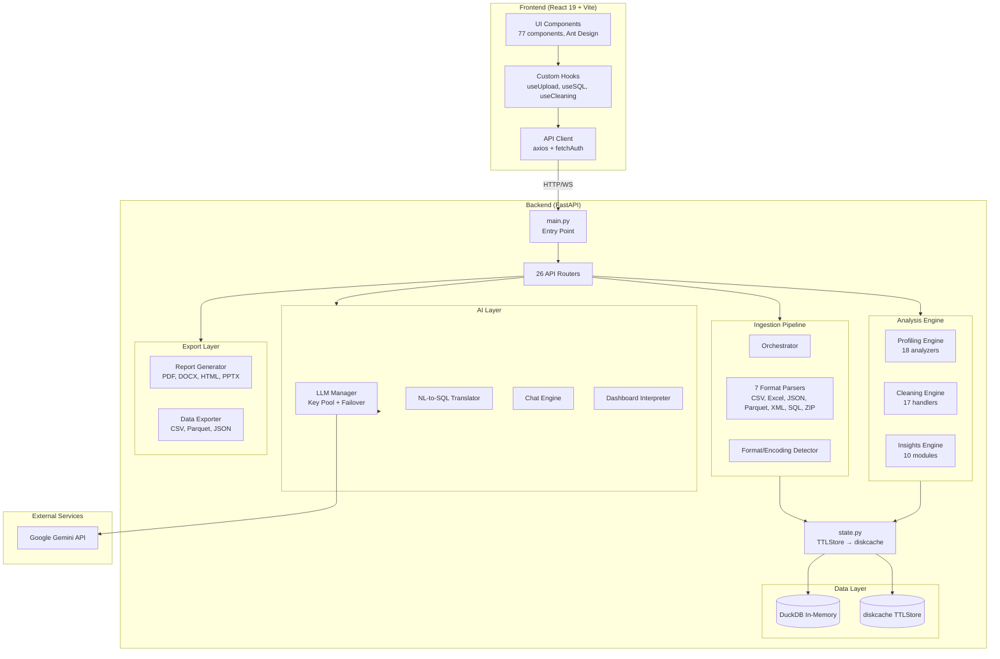

# 02 — Architecture

## Component Map

```
PRISM/
├── backend/              Python FastAPI monolith
│   ├── main.py           App entry point, lifespan, router wiring
│   ├── config.py         All config via env vars (AppConfig, LLMConfig, IngestionConfig, CleaningConfig)
│   ├── state.py          Unified data-access layer (TTLStore → diskcache)
│   ├── api/              26 FastAPI router modules (one per feature)
│   ├── ingestion/        File parsing pipeline (orchestrator + 7 format parsers)
│   ├── profiling/        18-module deep statistical profiler
│   ├── cleaning/         17-handler autonomous cleaning engine
│   ├── insights/         10-module hypothesis/anomaly/relationship engine
│   ├── dashboard/        AI prompt → chart config → SQL pipeline
│   ├── sql/              DuckDB engine, NL-to-SQL, query builder, templates
│   ├── chat/             Gemini-powered conversational assistant
│   ├── reporting/        PDF/DOCX/HTML/PPTX report generation
│   ├── llm/              API key pool manager with failover
│   └── models/           Pydantic schemas
├── frontend/             React 19 + TypeScript SPA
│   ├── src/App.tsx       Main orchestrator with tab-based UI
│   ├── src/components/   77 UI components across 12 feature areas
│   ├── src/api/          4 API client modules (axios + fetch)
│   ├── src/hooks/        5 custom hooks (upload, SQL, session, theme, cleaning)
│   ├── src/types/        6 TypeScript type definition files
│   └── src/utils/        1 utility module
├── start.bat             Windows launcher (venv setup, npm install, server start)
└── stop.bat              Process killer
```

## Mermaid Architecture Diagram



## Runtime Model

| Aspect | Detail | Evidence |
|---|---|---|
| Server | Single-process uvicorn, async | [main.py:179-184](file:///c:/abbu/backend/main.py#L179-L184) |
| Concurrency | asyncio event loop, no thread pool for compute | No `run_in_executor` calls found |
| Workers | **1 worker only** (stated in docstring) | [main.py:4-6](file:///c:/abbu/backend/main.py#L4-L6) |
| State | In-process `diskcache` TTLStore, shared via module globals | [state.py:67-77](file:///c:/abbu/backend/state.py#L67-L77) |
| Background tasks | FastAPI `BackgroundTasks` for upload processing | [api/upload.py:156](file:///c:/abbu/backend/api/upload.py#L156) |
| WebSocket | Single connection per file_id for progress | [api/upload.py:402-432](file:///c:/abbu/backend/api/upload.py#L402-L432) |
| Cron / Scheduled | None | — |
| Rate limiting | slowapi (in-memory, per-IP) | [main.py:111-116](file:///c:/abbu/backend/main.py#L111-L116) |

## Third-Party Integrations

| Integration | Purpose | Coupling |
|---|---|---|
| Google Gemini API | NL-to-SQL, chat, dashboard interpretation, story generation, hypothesis generation | Deep — used across 6+ modules |
| DuckDB | All SQL analytics | Core dependency |
| diskcache | State persistence with TTL | Core dependency |

## Deployment Topology

[VERIFIED] **Local-only.** No Dockerfile, no CI/CD pipeline, no IaC. Deployment is `start.bat` on a Windows machine which:
1. Creates a Python venv
2. Installs backend deps
3. Installs frontend deps
4. Starts uvicorn in a new cmd window
5. Starts Vite dev server in a new cmd window
6. Opens browser to localhost:5173

No production build, no reverse proxy, no TLS.
