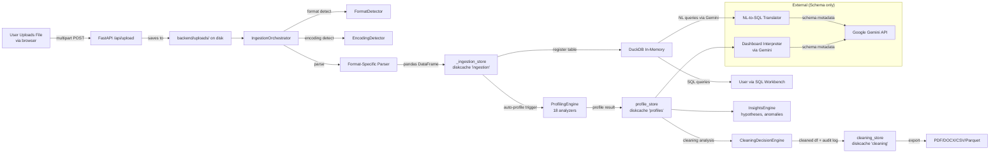

# 03 — Data Story

## Data Flow: End-to-End

## Data Origins

| Source | Format | Entry Point |
|---|---|---|
| User file upload | CSV, XLSX, JSON, Parquet, XML, SQL, ZIP/GZ | `POST /api/upload` |
| Secondary upload | Same | Mid-session modal in frontend |

## Storage Locations

| Store | Backend | TTL | What's Stored |
|---|---|---|---|
| `_ingestion_store` | diskcache `ingestion/` | 2 hours | DataFrame + metadata + malformed report |
| `profile_store` | diskcache `profiles/` | 7 days | Full profiling result dict |
| `cleaning_store` | diskcache `cleaning/` | 7 days | Cleaning engine state + plan |
| `target_store` | diskcache `targets/` | 7 days | ML target variable analysis |
| `tag_store` | diskcache `tags/` | 30 days | User column tags |
| `annotation_store` | diskcache `annotations/` | 30 days | User annotations |
| `recipe_store` | diskcache `recipes/` | 365 days | Cleaning recipes |
| `watchlist_store` | diskcache `watchlist/` | 30 days | Anomaly watchlist |
| `_dashboard_store` | diskcache `dashboard_local_cache/` | 24 hours | Dashboard widget results |
| DuckDB | In-memory `:memory:` | Session | Registered DataFrames as SQL tables |
| `uploads/` | Filesystem | Forever (no cleanup) | Raw uploaded files |
| `temp/` | Filesystem | Forever (no cleanup) | Extracted ZIP contents |

## Schemas and Indexes

**No database schemas.** All data is in-memory pandas DataFrames registered into DuckDB's in-memory engine. No persistent database, no migrations, no indexes beyond DuckDB's internal structures.

## Sensitive / PII Fields

[INFERRED] The platform processes **arbitrary user data**. Since users upload their own datasets, any column could contain PII. The system:
- Does NOT classify or flag PII columns [VERIFIED — no PII detection in profiling]
- Does send **schema metadata + sample values** to Gemini API ([nl_query.py:57-63](file:///c:/abbu/backend/sql/nl_query.py#L57-L63))
- Sample values sent include `.head(5)` rows from each column — this CAN leak PII to Google

## Data Leaving the System

| Destination | What's Sent | Evidence |
|---|---|---|
| Google Gemini API | Column names, dtypes, sample values (head 5), user prompts | [nl_query.py](file:///c:/abbu/backend/sql/nl_query.py), [chat/engine.py](file:///c:/abbu/backend/chat/engine.py), [dashboard/prompt_interpreter.py](file:///c:/abbu/backend/dashboard/prompt_interpreter.py) |
| User browser | DataFrame previews, query results, profiling stats | All API responses |
| Filesystem exports | PDF, DOCX, CSV, Parquet files | [reporting/](file:///c:/abbu/backend/reporting/) |

## Retention and Backups

- **No backup mechanism** exists
- **No data deletion** endpoint (files in `uploads/` accumulate forever)
- TTL-based eviction in diskcache handles memory, but uploaded files remain on disk
- **No GDPR-style data subject access or deletion** capability

## Entity-Relationship Summary

No relational schema exists. The "entities" are:

| Entity | Key | Relationships |
|---|---|---|
| UploadedFile | `file_id` (UUID) | → IngestionResult, Profile, CleaningState, TargetState |
| Profile | `file_id` | Depends on UploadedFile |
| CleaningState | `file_id` | Depends on UploadedFile + Profile |
| TargetState | `file_id` | Written by Profiling, read by ML/Story/Report |
| DuckDB Table | `table_name` | Registered from DataFrame, queryable |
| Dashboard | `id` (UUID) | Stored in `_dashboard_store`, references `file_id` |
