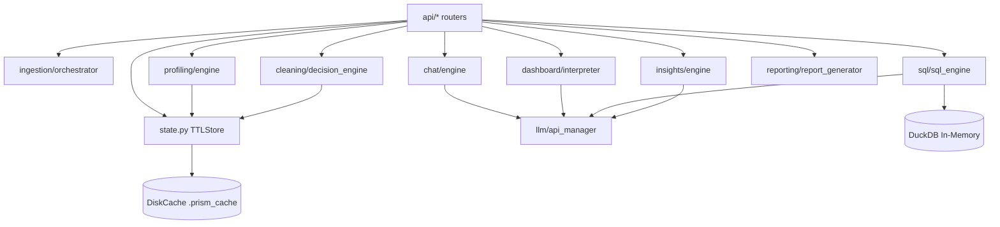

# 05 — Dependency Map

## Backend Dependencies (`backend/requirements.txt`)

| Package | Pinned Version / Spec | Purpose | Maintained? | License | Known CVEs / Risk |
|---|---|---|---|---|---|
| `fastapi` | `>=0.115.6` | Web API framework | Yes (Active) | MIT | Low risk; floating `>=` |
| `uvicorn[standard]` | `>=0.34.0` | ASGI web server | Yes (Active) | BSD-3-Clause | Floating `>=` |
| `python-multipart` | `>=0.0.20` | Streaming file uploads multipart/form-data | Yes (Active) | Apache-2.0 | Prior DoS vulnerabilities (CVE-2024-24762 fixed in 0.0.7+) |
| `python-dotenv` | (unpinned) | Environment variable loading | Yes (Active) | BSD-3-Clause | Completely unpinned |
| `pandas` | `>=2.2.3` | Core in-memory data processing | Yes (Active) | BSD-3-Clause | Heavy memory footprint on large datasets |
| `pyarrow` | `>=18.1.0` | Parquet parsing and arrow storage | Yes (Apache) | Apache-2.0 | Memory safe binary backend |
| `openpyxl` | `>=3.1.5` | Excel (.xlsx) parsing | Yes (Active) | MIT | Billion laughs XML bomb risk if untrusted |
| `xlrd` | `>=2.0.1` | Legacy Excel (.xls) parsing | Minimal (frozen) | BSD-4-Clause | XLS format parsing risks |
| `duckdb` | `>=1.1.3` | In-memory embedded OLAP SQL engine | Yes (Very Active) | MIT | Embedded C++ engine |
| `charset-normalizer` | `>=3.4.1` | Text encoding auto-detection | Yes (Active) | MIT | Fallback encoding detection |
| `python-magic-bin` | `>=0.4.14` | MIME type detection on Windows | Minimal | MIT | Windows native DLL bindings |
| `clevercsv` | `>=0.8.2` | Robust CSV dialect detection | Yes (Academic/OSS) | MIT | Regex/sampling parser |
| `xmltodict` | `>=0.14.1` | XML to JSON/dict converter | Yes | MIT | Vulnerable to XML entity expansion unless disabled |
| `sqlparse` | `>=0.5.3` | SQL syntax parsing and AST | Yes | BSD-3-Clause | Past ReDoS issues (CVE-2024-4340 fixed in 0.5.0+) |
| `ijson` | `>=3.3.0` | Iterative streaming JSON parser | Yes | BSD-3-Clause | Safe C-backend streaming |
| `psutil` | `>=6.1.1` | System memory/CPU monitoring | Yes | BSD-3-Clause | Native OS hooks |
| `diskcache` | (unpinned) | Persistent file cache on disk | Yes | Apache-2.0 | SQLite-backed cache, no encryption at rest |
| `scipy` | `>=1.14.1` | Statistical distributions & tests | Yes | BSD-3-Clause | High quality |
| `scikit-learn` | `>=1.6.1` | Feature importance & ML metrics | Yes | BSD-3-Clause | Heavy dependency |
| `statsmodels` | `>=0.14.4` | Time-series decomposition & regression | Yes | BSD-3-Clause | Heavy dependency |
| `nltk` | (unpinned) | Natural language text cleaning | Yes | Apache-2.0 | Downloads data corpora at runtime if missing |
| `textblob` | (unpinned) | Sentiment analysis | Low activity | MIT | Relies on NLTK |
| `langdetect` | (unpinned) | Natural language identification | Low activity | Apache-2.0 | Non-deterministic seed |
| `jellyfish` | (unpinned) | String distance (Levenshtein/Jaro) | Yes | MIT | C extension for string comparisons |
| `google-genai` | (unpinned) | Official Google Gemini SDK | Yes (Google) | Apache-2.0 | Critical single point of failure for AI features |
| `python-docx` | (unpinned) | Word document report generator | Yes | MIT | Unpinned |
| `python-pptx` | (unpinned) | PowerPoint report generator | Yes | MIT | Unpinned |
| `fpdf2` | (unpinned) | PDF report generator | Yes | LGPLv3 | Note LGPL license implications |
| `slowapi` | (unpinned) | Rate limiting middleware | Yes | MIT | In-memory limiter, won't scale across workers |
| `pytest` | `>=8.3.4` | Test runner | Yes | MIT | Dev dependency |
| `pytest-asyncio` | `>=0.24.0` | Async test runner | Yes | Apache-2.0 | Dev dependency |
| `httpx` | `>=0.28.1` | Async HTTP client for tests | Yes | BSD-3-Clause | Dev dependency |

### Dependency Issues & Risks (Backend)
1. **Unpinned dependencies in requirements.txt**: 10+ packages (`python-dotenv`, `diskcache`, `nltk`, `textblob`, `langdetect`, `jellyfish`, `google-genai`, `python-docx`, `python-pptx`, `fpdf2`, `slowapi`) have NO version constraints. Builds are non-reproducible across fresh machines.
2. **License notice**: `fpdf2` is LGPL-3.0. Commercial distribution must review LGPL requirements.
3. **Missing Lockfile**: No Poetry/uv/pip-tools lockfile in CI or repository.

---

## Frontend Dependencies (`frontend/package.json`)

| Package | Version Spec | Purpose | Maintained? | License |
|---|---|---|---|---|
| `react` | `^19.2.0` | UI framework | Yes (Meta) | MIT |
| `react-dom` | `^19.2.0` | DOM renderer | Yes (Meta) | MIT |
| `antd` | `^6.3.1` | Primary design system component library | Yes (Ant Group) | MIT |
| `@ant-design/icons` | `^6.1.0` | UI icon set | Yes | MIT |
| `ag-grid-community` | `^35.1.0` | High-performance data grid table | Yes | MIT |
| `ag-grid-react` | `^35.1.0` | React wrapper for AG-Grid | Yes | MIT |
| `axios` | `^1.13.6` | HTTP client | Yes | MIT |
| `echarts` | `^5.6.0` | Visualization charting library | Yes (Apache) | Apache-2.0 |
| `echarts-for-react` | `^3.0.6` | React wrapper for Apache ECharts | Yes | MIT |
| `echarts-wordcloud` | `^2.1.0` | Word cloud plugin for ECharts | Low activity | MIT |
| `recharts` | `^3.7.0` | Secondary charting library | Yes | MIT |
| `react-grid-layout` | `^2.2.2` | Draggable dashboard grid system | Yes | MIT |
| `html2canvas` | `^1.4.1` | Client-side screenshot exporter | Maintenance only | MIT |
| `jspdf` | `^4.2.0` | Client-side PDF generator | Yes | MIT |

### Frontend Development Dependencies
- `vite` (`^7.3.1`), `vitest` (`^4.0.18`), `typescript` (`~5.9.3`), `eslint` (`^9.39.1`)
- Package lock exists: `package-lock.json` (232 KB) [VERIFIED]

---

## Internal Module Dependency Graph

